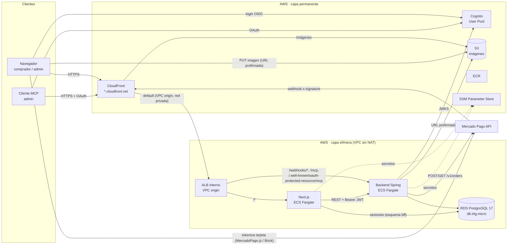
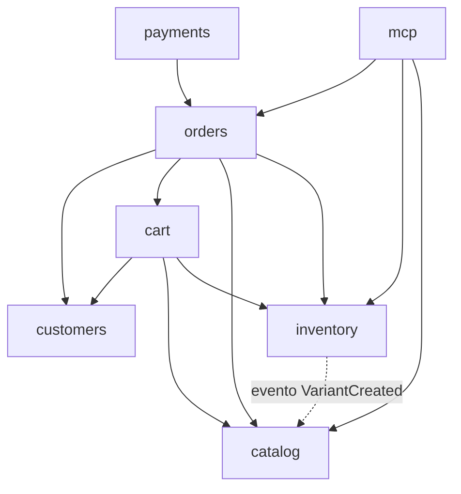
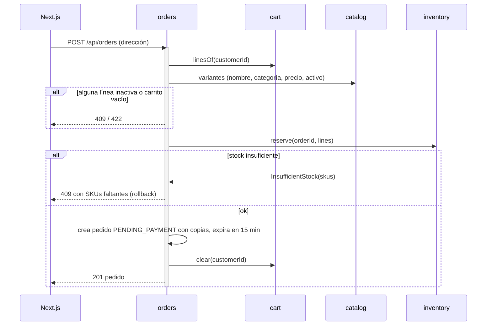
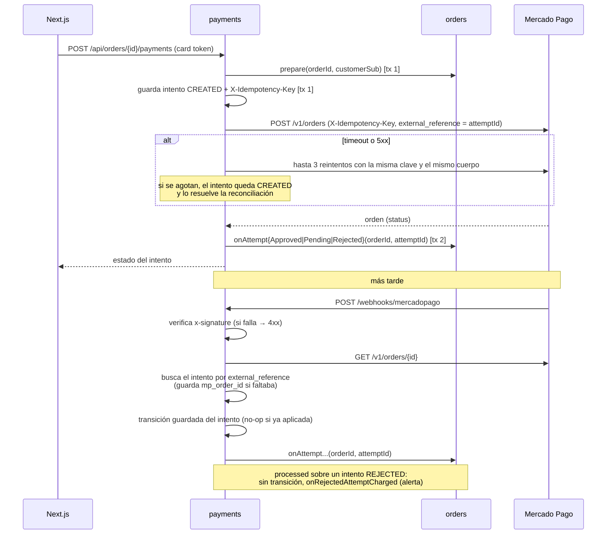
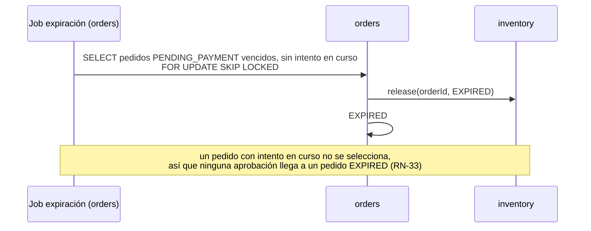
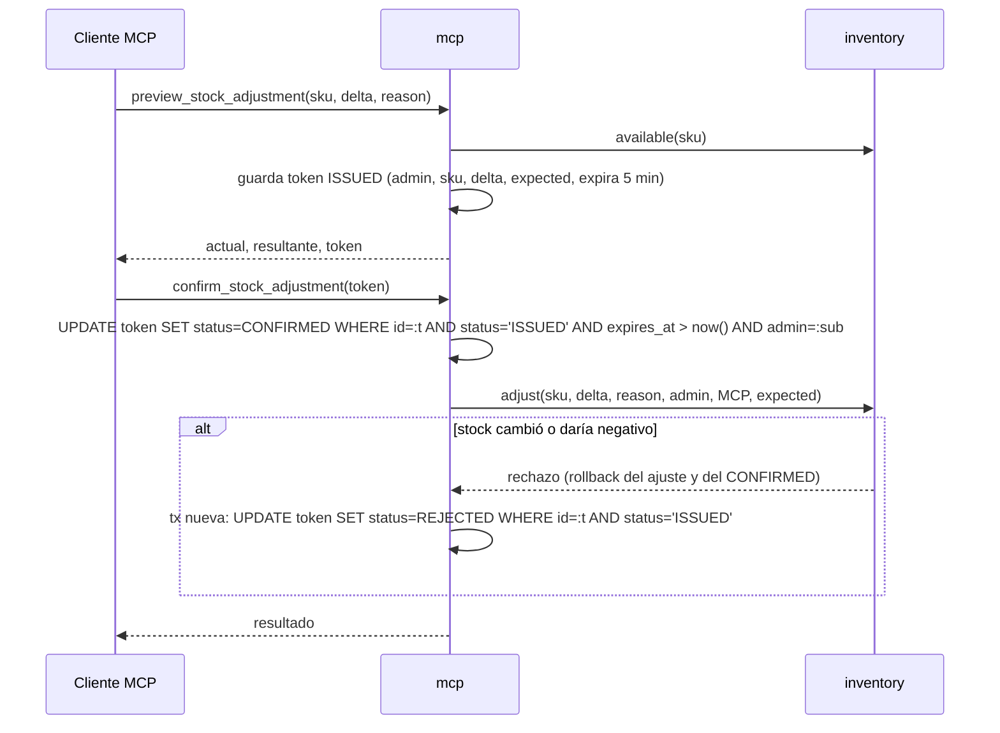
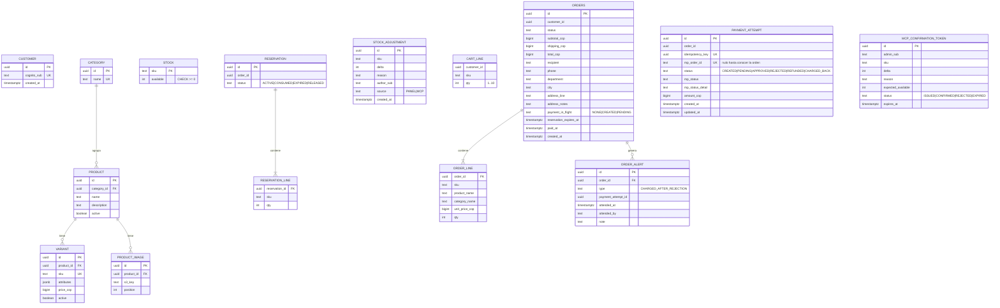

# BitMarket — Arquitectura

> **Cómo** está construido el sistema. El **qué** (casos de uso y reglas RN-xx) vive en [`design.md`](design.md); el porqué de cada decisión, en [`adr/`](adr/). Contexto general en [`brief.md`](brief.md).

## 1. Propósito y referencias

Monolito modular en Java 25 + Spring Boot 4.1 con Spring Modulith 2.x ([ADR-0001](adr/0001-monolito-modular-spring-modulith.md)), frontend Next.js que actúa como BFF ([ADR-0011](adr/0011-nextjs-como-bff.md)), PostgreSQL 17 con Spring Data JPA ([ADR-0012](adr/0012-persistencia-spring-data-jpa.md)), pagos con Mercado Pago Checkout API vía Orders API ([ADR-0004](adr/0004-mercado-pago-checkout-api.md)), identidad con Amazon Cognito ([ADR-0007](adr/0007-cognito-como-proveedor-de-identidad.md)) y despliegue en AWS con Terraform en dos capas ([ADR-0010](adr/0010-infraestructura-efimera-terraform-fargate.md)), con el ALB interno como *VPC origin* de CloudFront ([ADR-0014](adr/0014-cloudfront-vpc-origin-alb-interno.md)).

## 2. Vista general



- El navegador **solo** habla con Next.js (más Cognito, Mercado Pago para tokenizar y S3 para subir imágenes). El backend recibe tráfico público únicamente en `/webhooks/*`, `/mcp` y `/.well-known/oauth-protected-resource/mcp`.
- El ALB es interno, en subredes privadas y sin IP pública; CloudFront llega a él como *VPC origin* ([ADR-0014](adr/0014-cloudfront-vpc-origin-alb-interno.md)). Las tareas Fargate se ejecutan en subredes públicas con IP pública (consecuencia de no tener NAT Gateway) y security groups que solo aceptan tráfico del ALB. RDS vive en subredes privadas y solo acepta tráfico de los security groups del backend y de Next.js (este último solo para su esquema de sesiones `bff`).

## 3. Módulos del backend

Paquete base `com.bitmarket`. Cada módulo es un paquete de primer nivel; su API pública son los tipos del paquete raíz del módulo; todo lo de `internal/` es privado. `ApplicationModules.verify()` en CI lo hace cumplir.

| Módulo | Responsabilidad | Expone (API pública) | Depende de | Reglas |
| --- | --- | --- | --- | --- |
| `customers` | Perfil local vinculado al `sub` de Cognito. | `Customers.resolve(sub) → CustomerId` (crea si no existe). | — | RN-40, RN-42 |
| `catalog` | Categorías, productos, variantes, activación, imágenes (URL prefirmada S3), búsqueda por nombre. | `CatalogQueries` (variante por SKU: nombre, categoría, precio, activo); evento `VariantCreated`; REST de tienda y de admin. | — | RN-01–RN-07 |
| `inventory` | Stock disponible por SKU, reservas, ajustes delta. | `Inventory.reserve(orderId, lines)`, `release(orderId, reason)`, `consume(orderId)`, `adjust(...)`, `available(skus)`, `lowStock(threshold)`. | `catalog` (solo el evento `VariantCreated`) | RN-30–RN-38 |
| `cart` | Carrito por usuario en servidor. | `Carts.linesOf(customerId)`, `Carts.clear(customerId)`; REST de carrito. | `customers`, `catalog`, `inventory` | RN-10–RN-16 |
| `orders` | Checkout, pedido y su máquina de estados, copias, cancelación, envío, expiración, alertas de cobro, consultas de ventas. | `OrderPayments` (preparar pago, validando propiedad, y notificar resultado); `OrderQueries` (pedidos y ventas); REST de tienda y admin; job de expiración. | `customers`, `cart`, `catalog`, `inventory` | RN-20–RN-27, RN-32, RN-36, RN-37, RN-50, RN-51, RN-75 |
| `payments` | Intentos de pago, integración con Mercado Pago, webhook, reconciliación. | REST `POST /api/orders/{id}/payments`; `POST /webhooks/mercadopago`; job de reconciliación. | `orders` | RN-60–RN-69 |
| `mcp` | Servidor MCP (Spring AI 2.0 MCP Server, Streamable HTTP), tools tipadas y tokens de confirmación. | Endpoint `/mcp`. | `orders`, `inventory`, `catalog` | RN-70–RN-76 |

Además, un paquete `com.bitmarket.shared` (no es módulo de negocio) con tipos de valor transversales (`Money` en COP entero, `Sku`, `CustomerId`) y configuración de seguridad/observabilidad.



Regla: **sin ciclos entre módulos**. Por eso el checkout vacía el carrito con una llamada síncrona `orders → Carts.clear()` en su misma transacción, en lugar de con un evento que `cart` escuche.

## 4. Frontend Next.js

- **App Router**, renderizado en servidor para el catálogo (SEO).
- **Better Auth** con proveedor Cognito (OIDC). Sesiones y tokens de Cognito (access y refresh) se guardan en el esquema `bff` de PostgreSQL, propiedad exclusiva de Next.js; el navegador solo recibe una cookie de sesión `httpOnly`. El access token **nunca** llega al JavaScript del navegador. Better Auth lo renueva con el refresh token al pedirlo (`auth.api.getAccessToken`).
- **Cierre de sesión:** borra la sesión de Better Auth (fila en `bff.session` y cookie) y redirige al endpoint `/logout` de Cognito con `client_id` y `logout_uri`; si no, la sesión de Managed Login sigue viva y el siguiente login entra sin pedir credenciales. Cada `logout_uri` (local y CloudFront) se registra en las *allowed sign-out URLs* del app client.
- **BFF:** las páginas, *server actions* y *route handlers* de Next.js llaman al backend por REST con `Authorization: Bearer <access token>`. Tipos TypeScript generados desde el OpenAPI del backend (`openapi-typescript`).
- **Pago:** el Card Payment Brick (MercadoPago.js) se ejecuta en el navegador con la *public key* de Mercado Pago; el token de tarjeta resultante se envía a Next.js y de ahí al backend.
- **Áreas:** tienda (catálogo, carrito, checkout, "Mis pedidos") y panel `/admin` (exige grupo `ADMIN`; el backend vuelve a verificarlo).

## 5. Comunicación entre módulos y contratos

### 5.1 Llamadas síncronas

- Un módulo solo invoca a otro a través de los tipos públicos del paquete raíz de ese módulo. Nunca accede a sus repositorios, entidades ni tablas.
- Se usa llamada síncrona cuando la operación debe ser **atómica en la misma transacción** de base de datos: reservar/liberar/consumir stock al cambiar el estado del pedido, vaciar el carrito en el checkout y aplicar el resultado de un pago al pedido.
- Las entidades JPA no tienen relaciones (`@ManyToOne`, etc.) hacia entidades de otro módulo; solo guardan su identificador (`sku`, `orderId`, `customerId`).

Contratos principales:

| Contrato | Operación | Comportamiento |
| --- | --- | --- |
| `Inventory.reserve(orderId, lines)` | Reserva todo o nada | Por cada línea `UPDATE stock SET available = available - :qty WHERE sku = :sku AND available >= :qty`; si alguna afecta 0 filas lanza `InsufficientStock(skus)` y la transacción se revierte (RN-31, RN-37). |
| `Inventory.release(orderId, reason)` | Devuelve stock | Reserva `ACTIVE → EXPIRED` (`reason = EXPIRED`, job de expiración) o `ACTIVE → RELEASED` (`reason = CANCELLED`, el comprador cancela); suma `available`. Idempotente. |
| `Inventory.consume(orderId)` | Marca consumida | Reserva `ACTIVE → CONSUMED`. Idempotente. |
| `Inventory.adjust(sku, delta, reason, author, source, expectedAvailable?)` | Ajuste delta | `UPDATE ... SET available = available + :delta WHERE sku = :sku AND available + :delta >= 0 [AND available = :expected]`; registra el ajuste (RN-34, RN-38, RN-74). |
| `OrderPayments.prepare(orderId, customerSub)` | Antes de crear un intento | Resuelve el `CustomerId` con `Customers.resolve(sub)`; si el pedido no es suyo responde como no encontrado (RN-42). Bloquea el pedido (`SELECT ... FOR UPDATE`), valida `PENDING_PAYMENT`, reserva vigente y sin intento en curso; marca `payment_in_flight = CREATED`; devuelve el monto (RN-65, RN-69). |
| `OrderPayments.onAttemptPending / onAttemptRejected / onAttemptApproved(orderId, attemptId)` | Resultado del intento | Actualiza `payment_in_flight` y transiciona el pedido según §5.1 de `design.md`; al aprobar, `PENDING_PAYMENT → PAID` y `Inventory.consume` en la misma transacción (RN-22). Si el pedido no está en `PENDING_PAYMENT` (imposible por RN-33), la transición afecta 0 filas y se registra como error (RN-20). |
| `OrderPayments.onRejectedAttemptCharged(orderId, attemptId)` | Cobro sobre un intento `REJECTED` | No cambia el pedido; crea una alerta `CHARGED_AFTER_REJECTION` para reembolso manual. Idempotente: una sola alerta por intento (RN-66, RN-27). |

### 5.2 Eventos de dominio (en proceso, con outbox)

Spring Modulith *event publication registry* sobre JDBC: el evento se guarda en la misma transacción que lo origina y se entrega después del commit a listeners `@ApplicationModuleListener` (transacción propia, asíncrono). Las publicaciones que no se completan las marca como `FAILED` el *Staleness Monitor* de Spring Modulith 2 (umbrales configurados) y un job programado las reenvía con `FailedEventPublications`. No se usa el reenvío al reiniciar (`republish-outstanding-events-on-restart`), desaconsejado con varias réplicas. **Todo listener debe ser idempotente.**

| Evento | Emisor | Consumidor | Contenido | Efecto |
| --- | --- | --- | --- | --- |
| `VariantCreated` | `catalog` | `inventory` | `sku`, `initialStock` | Crea la fila de stock. Mientras no exista, el stock disponible de ese SKU es 0. |

Añadir un evento exige añadir su fila a esta tabla.

### 5.3 Contratos HTTP

El contrato vinculante es el **OpenAPI generado por springdoc-openapi**; las rutas siguientes son indicativas.

| Superficie | Rutas | Autenticación |
| --- | --- | --- |
| Tienda (vía BFF) | `GET /api/catalog/...` (público); `/api/cart/...`; `POST /api/orders` (checkout), `GET /api/orders[/{id}]`, `POST /api/orders/{id}/cancel`, `POST /api/orders/{id}/payments` | JWT de Cognito, grupo `CUSTOMER` (salvo catálogo) |
| Administración (vía BFF) | `/api/admin/products`, `/api/admin/variants/{sku}/stock-adjustments`, `/api/admin/images/upload-url`, `/api/admin/orders/{id}/ship`, `/deliver`, `/api/admin/alerts/{id}/attend` | JWT, grupo `ADMIN` |
| Webhook | `POST /webhooks/mercadopago` | `x-signature` (HMAC con el secreto del webhook) |
| MCP | `/mcp` (Streamable HTTP); la respuesta 401 incluye `WWW-Authenticate: Bearer resource_metadata="…"` | OAuth de Cognito, grupo `ADMIN` |
| Metadatos MCP | `GET /.well-known/oauth-protected-resource/mcp` (RFC 9728: `resource` = URL del MCP, `authorization_servers` = emisor de Cognito) | Ninguna |
| Salud | `GET /actuator/health` | Ninguna; solo accesible desde el ALB |

Errores: `application/problem+json` (RFC 9457).

Tools MCP (nombres indicativos): `list_orders`, `get_order`, `sales_by_category`, `low_stock_variants(threshold = 5)`, `preview_stock_adjustment(sku, delta, reason)`, `confirm_stock_adjustment(token)`.

### 5.4 Flujos clave

**Checkout** (CU-04)



**Pago síncrono y webhook** (CU-05, CU-12)



**Expiración de reservas** (CU-13)



**Ajuste de stock por MCP** (CU-11)



## 6. Modelo de datos

PostgreSQL 17, la misma versión en RDS, en Docker Compose y en Testcontainers. Esquema versionado con **Flyway**; datos semilla en cada `apply` del entorno efímero y en local. Cada tabla pertenece a un único módulo y solo ese módulo la lee o escribe.



| Módulo | Tablas |
| --- | --- |
| `customers` | `customer` |
| `catalog` | `category`, `product`, `variant`, `product_image` |
| `inventory` | `stock`, `reservation`, `reservation_line`, `stock_adjustment` |
| `cart` | `cart_line` |
| `orders` | `orders`, `order_line`, `order_alert` |
| `payments` | `payment_attempt` |
| `mcp` | `mcp_confirmation_token` |
| Spring Modulith | `event_publication` |
| Next.js (BFF, esquema `bff`) | Tablas de Better Auth (`user`, `session`, `account`, `verification`) |

- Las relaciones **entre módulos** (`sku`, `order_id`, `customer_id`) no tienen clave foránea: son referencias por identificador.
- Una migración de Flyway del backend crea solo el esquema `bff` y el rol `bitmarket_bff` (contraseña por *placeholder* de Flyway desde SSM o `.env`), con permisos únicamente sobre ese esquema. Las tablas de `bff` las crea y migra Better Auth desde Next.js; el código del backend nunca las lee ni las escribe.
- Montos en `bigint` COP (RN-02). `CHECK (available >= 0)` como red de seguridad de RN-30.
- Las transiciones de estado se escriben como `UPDATE ... WHERE id = :id AND status IN (:origenes_validos)` y se comprueban las filas afectadas; así una notificación duplicada no produce una segunda transición (RN-66).
- `order_alert` tiene `UNIQUE (payment_attempt_id)` (columna obligatoria): una notificación repetida no duplica alertas.

## 7. Integraciones externas y manejo de fallos

| Integración | Uso | Fallos y respuesta |
| --- | --- | --- |
| **Mercado Pago** `POST /v1/orders` | Crear una orden por intento (`processing_mode = automatic`, una transacción de pago) con token de tarjeta, `X-Idempotency-Key` y `external_reference` = ID del intento (ambos UUID: la cabecera admite de 1 a 128 caracteres y `external_reference` hasta 64) | Timeouts de conexión y lectura explícitos y configurables. Timeout o 5xx → hasta **3 reintentos** con la **misma** clave y el **mismo** cuerpo (RN-62); 409 `idempotency_key_already_used` o 423 `resource_locked` en un reintento → no se reintenta más y el intento queda `CREATED` (AQ-03). 429 → esperar `Retry-After`. Sin respuesta definitiva tras los reintentos (o caída del proceso) → el intento queda `CREATED` y lo resuelve la reconciliación. 4xx de validación → `REJECTED` con el detalle. |
| **Mercado Pago** `GET /v1/orders/{id}` | Estado real tras webhook y en reconciliación | Si falla en el webhook → responder 5xx para que Mercado Pago reintente; la reconciliación es el respaldo (RN-68). |
| **Mercado Pago** búsqueda de órdenes `GET /v1/orders` por `external_reference` (con `begin_date`/`end_date` obligatorios) | Resolver intentos huérfanos en `CREATED` | Si existe la orden, se aplica su estado; si no existe, el intento pasa a `REJECTED` y deja de bloquear nuevos intentos. Si la búsqueda falla, se reintenta en la siguiente ejecución. |
| **Mercado Pago** webhook | Notificación de cambio de orden (evento *Order (Mercado Pago)*, tópico `order`, configurado en el panel de la aplicación con URLs separadas para Prueba y Producción; la Orders API no admite `notification_url` por petición) | Verificación de `x-signature` (HMAC-SHA256 del manifiesto con `data.id` del query string **en minúsculas** (los IDs `ORD…` llegan en mayúsculas), `x-request-id` y `ts`, comparado en tiempo constante). Inválida → 4xx sin efectos (RN-63). El cuerpo solo aporta el ID de la orden. El intento se identifica por el `external_reference` de la respuesta de `GET /v1/orders/{id}`, no por `mp_order_id`, que un huérfano en `CREATED` todavía no tiene; si faltaba, se guarda. Si la API devuelve `processed` para un intento ya `REJECTED`, no hay transición y se llama a `onRejectedAttemptCharged` (RN-66). CloudFront reenvía `/webhooks/*` al ALB sin caché, con método `POST`, query string y las cabeceras `x-signature` y `x-request-id`. |
| **Cognito** (plan Essentials, Managed Login) | Login OIDC (Better Auth), validación de JWT (backend), OAuth del MCP | El backend valida firma, `iss`, `exp` y `token_use` con JWKS cacheado por Spring Security; roles desde `cognito:groups`. En `/mcp` valida además que `aud` sea la URL del MCP (token emitido con *resource indicators*, RFC 8707). Cognito caído → no hay login nuevo; las sesiones vigentes siguen hasta expirar. |
| **S3** | Imágenes de producto | La URL prefirmada se genera localmente (sin llamada de red), con caducidad corta y tipo de contenido restringido. Fallo de subida → el admin reintenta; el producto no referencia la imagen hasta confirmar la subida. |

La integración con Mercado Pago está aislada en `payments/internal` detrás de una interfaz propia, para poder simularla en tests y no filtrar tipos del proveedor a otros módulos.

## 8. Jobs programados

| Job | Módulo | Frecuencia | Concurrencia entre réplicas |
| --- | --- | --- | --- |
| Expiración de reservas | `orders` | Cada 1 min (configurable) | `SELECT ... FOR UPDATE SKIP LOCKED` sobre pedidos `PENDING_PAYMENT` con `reservation_expires_at < now()` y `payment_in_flight = 'NONE'` (RN-33, RN-36, RN-69). |
| Reconciliación de pagos | `payments` | Cada 5 min (configurable): intentos `PENDING` con > 10 min (consulta por ID) e intentos `CREATED` con > 2 min (búsqueda por `external_reference`) | `SELECT ... FOR UPDATE SKIP LOCKED`; la transición guardada evita doble efecto (RN-66, RN-68). |

Implementados con `@Scheduled` de Spring; las consultas de bloqueo son `@Query(nativeQuery = true)` (con `@Modifying` cuando actualizan) en los repositorios del módulo.

## 9. Seguridad

- **Autenticación y roles:** Cognito; backend como *OAuth2 resource server* que valida JWT y mapea `cognito:groups` a `ROLE_CUSTOMER` / `ROLE_ADMIN` (RN-44). El grupo `CUSTOMER` lo asigna el disparador *Post Confirmation* de Cognito al confirmar el registro; un usuario sin grupo no accede a las rutas de comprador (403). Autorización comprobada en el backend aunque el BFF ya filtre.
- **Propiedad de recursos:** toda consulta de carrito o pedido del comprador filtra por el `CustomerId` resuelto del JWT; un recurso ajeno responde 404 (RN-42).
- **Webhook:** público solo en `/webhooks/mercadopago`, protegido por `x-signature` (RN-63).
- **PCI:** el backend solo recibe el token de tarjeta; nunca datos de tarjeta (RN-60). El token no se registra en logs.
- **Secretos:** nunca en el repositorio. En AWS, **SSM Parameter Store `SecureString`** inyectados por ECS como variables de entorno (access token de Mercado Pago, secreto del webhook, secreto de Better Auth, client secret de Cognito, contraseña del rol `bitmarket_bff`). La contraseña maestra de RDS la gestiona RDS en Secrets Manager. En local, archivo `.env` ignorado por git.
- **Datos personales mínimos:** el backend solo guarda el `sub` de Cognito y la dirección copiada en el pedido (RN-40, RN-41). El esquema `bff` guarda además el correo y el nombre que exige Better Auth. Los logs no incluyen dirección, teléfono ni correo.
- **Base de datos:** Next.js se conecta con el rol `bitmarket_bff`, que solo tiene permisos sobre el esquema `bff`: un fallo en el BFF no da acceso a pedidos, stock ni pagos. El backend usa su propio usuario.
- **Red:** RDS sin acceso público (solo desde backend y Next.js); tareas Fargate solo aceptan tráfico del ALB; el ALB es interno (sin IP pública) y solo acepta tráfico del security group que CloudFront gestiona para su VPC origin (`CloudFront-VPCOrigins-Service-SG`, [ADR-0014](adr/0014-cloudfront-vpc-origin-alb-interno.md)). El tramo CloudFront → ALB va por HTTP dentro de la red de AWS: sin dominio propio no hay certificado para el ALB.
- **CI/CD:** GitHub Actions se autentica en AWS por **OIDC** con un rol de alcance limitado; no hay llaves de AWS guardadas.

## 10. Observabilidad

- **Logs** estructurados en JSON a stdout, enviados a **CloudWatch Logs** por el driver `awslogs` de ECS, con **retención de 7 días**.
- **Correlación:** cada petición lleva un `X-Request-Id` (lo genera Next.js si no existe y lo propaga al backend), guardado en el MDC y presente en cada línea de log.
- **Salud:** `/actuator/health` (con verificación de base de datos) como *health check* del target group del ALB.
- Sin métricas ni trazas externas en el MVP.

## 11. Caché

- **Sin Redis ni caché distribuida** (fuera de alcance en `brief.md` §4); se reevalúa solo ante una necesidad medida.
- JWKS de Cognito cacheado en memoria por Spring Security.
- CloudFront cachea las imágenes de S3.
- **El HTML del catálogo y las rutas hacia el backend no se cachean**: renderizado dinámico en cada petición, para que precio y disponibilidad estén siempre al día. Sin ISR. Se reevalúa con una necesidad medida.

## 12. Despliegue

### 12.1 Local

- `compose.yaml` en la raíz con PostgreSQL 17 (y opcionalmente backend y frontend construidos).
- Orden de arranque: primero el backend (Flyway crea el esquema `bff` y su rol), después el frontend, que ejecuta las migraciones de Better Auth (`pnpm auth:migrate`, también al arrancar su contenedor).
- Backend con `./mvnw spring-boot:run`, frontend con `pnpm dev`.
- **Cognito:** el User Pool de la capa permanente, con un app client propio cuyo callback es `http://localhost:3000/api/auth/callback/cognito` (Better Auth).
- **Mercado Pago:** sandbox real con cuentas de prueba. En local **no llegan webhooks**; los intentos `PENDING` se resuelven con el job de reconciliación (con un intervalo más corto configurable). El webhook se prueba con tests de integración y en AWS.

### 12.2 AWS

| Capa | Recursos | Ciclo de vida |
| --- | --- | --- |
| Permanente (`infra/permanent`) | Cognito User Pool y app clients (callback y *sign-out URLs* local y de CloudFront), Lambda *Post Confirmation* que añade al usuario al grupo `CUSTOMER` ([ADR-0013](adr/0013-grupo-customer-con-post-confirmation.md)), ECR (backend y frontend), S3 de imágenes, CloudFront, parámetros SSM, AWS Budgets, bucket S3 del estado de Terraform, rol IAM para OIDC de GitHub | Se crea y modifica en local y rara vez cambia; `env-up` y `env-down` la vuelven a aplicar desde CI solo para cambiar el origen de CloudFront. |
| Efímera (`infra/ephemeral`) | VPC (subredes públicas y privadas, sin NAT, con internet gateway), ALB interno y su *VPC origin* de CloudFront, ECS cluster y servicios Fargate (backend y Next.js), RDS PostgreSQL 17 `db.t4g.micro` | Se crea y destruye desde CI. |

- Región `us-east-1`. Las subredes del ALB evitan la zona `use1-az3`, que no admite VPC origins.
- Al arrancar, el backend ejecuta las migraciones de Flyway y carga datos semilla: el entorno efímero no conserva datos entre `apply`.
- Al arrancar, el contenedor de Next.js ejecuta las migraciones de Better Auth con el rol `bitmarket_bff` antes de `next start`, reintentando hasta que exista el esquema `bff`. Las migraciones son idempotentes; el servicio corre con una sola tarea en el MVP, así que no hay carreras entre réplicas. Las sesiones se pierden con cada `apply`, igual que los datos.
- La capa efímera etiqueta sus recursos con `bitmarket:created-at`.

### 12.3 CI/CD (GitHub Actions)

| Workflow | Disparador | Qué hace |
| --- | --- | --- |
| `ci` | PR y push a `main` | Backend: `./mvnw verify` (unitarios `*Test` con Surefire, integración `*IT` con Failsafe, Testcontainers y WireMock, `ApplicationModules.verify()`, `spotless:check` con google-java-format). Frontend: ESLint, Prettier (`format:check`), typecheck y Vitest. **E2E Playwright de humo** sobre Docker Compose, con Mercado Pago simulado. Es *required check* para fusionar en `main`. |
| `images` | Push a `main` | Construye y publica las imágenes en ECR, etiquetadas con el SHA del commit. |
| `env-up` | `workflow_dispatch` | 1) `terraform apply` de la capa efímera con la etiqueta de imagen elegida (crea el ALB interno y su VPC origin, que tarda hasta 15 min en desplegarse); 2) lee el output `vpc_origin_id`; 3) `terraform apply` de la capa permanente con esa variable, que solo cambia el origen de CloudFront; 4) espera a que ambos servicios ECS estén estables (Flyway y migraciones de Better Auth aplicadas). Autenticado por OIDC. |
| `env-down` | `workflow_dispatch` | Devuelve el origen de CloudFront a un valor *placeholder* (capa permanente), lo que desasocia el VPC origin, y ejecuta `terraform destroy` de la capa efímera. |
| `env-reaper` | `schedule` cada hora | Si la capa efímera existe y `bitmarket:created-at` tiene más de 4 h, ejecuta los mismos pasos que `env-down`. El entorno vive como máximo ~5 h. |

**E2E en CI:**
- **Mercado Pago:** WireMock simula `POST/GET /v1/orders` y la búsqueda, y Playwright intercepta MercadoPago.js / el Brick en el navegador.
- **Login:** un usuario E2E fijo del User Pool real, con las credenciales en los secretos de GitHub. Los PR desde forks no tienen acceso a esos secretos.
- **Compra sandbox real:** se verifica en el entorno AWS (criterio de éxito del brief).

**AWS Budgets:** presupuesto de 10 USD/mes con alertas por correo al 50 %, al 80 % y al 100 % del gasto real, y al 100 % del pronosticado.

## 13. Estructura del repositorio

Monorepo:

```
bitmarket/
├── AGENTS.md
├── CLAUDE.md
├── README.md
├── compose.yaml
├── .github/workflows/        # ci, images, env-up, env-down, env-reaper
├── docs/
│   ├── brief.md
│   ├── design.md
│   ├── architecture.md
│   └── adr/
├── backend/                  # Maven, Java 25, Spring Boot 4.1
│   ├── pom.xml
│   └── src/
│       ├── main/java/com/bitmarket/
│       │   ├── BitmarketApplication.java
│       │   ├── shared/
│       │   ├── customers/
│       │   ├── catalog/
│       │   │   ├── CatalogQueries.java      # API pública
│       │   │   ├── VariantCreated.java      # evento público
│       │   │   └── internal/                # entidades, repos, servicios, controladores
│       │   ├── inventory/
│       │   ├── cart/
│       │   ├── orders/
│       │   ├── payments/
│       │   └── mcp/
│       ├── main/resources/db/migration/     # Flyway
│       └── test/java/com/bitmarket/         # misma estructura por módulo
├── frontend/                 # Next.js (App Router), pnpm
│   ├── package.json
│   ├── src/app/              # (tienda) y admin/
│   ├── src/lib/api/          # cliente y tipos generados desde OpenAPI
│   └── e2e/                  # Playwright
└── infra/                    # Terraform
    ├── permanent/
    ├── ephemeral/
    └── modules/
```

## 14. Preguntas abiertas

- **AQ-01 Cliente MCP y OAuth con Cognito** (heredada de P-01 de `design.md`). La especificación de autorización de MCP (2026-07-28) recomienda documentos de metadatos de cliente, admite el registro previo y deja el registro dinámico como obsoleto. Cognito solo admite el registro previo, y emite tokens con `aud` del MCP mediante *resource indicators* (Managed Login, Essentials). Se resuelve con un spike temprano: primero MCP Inspector con un client ID registrado de antemano, después el cliente de la demo. Plan B: un proxy de autorización delgado delante de Cognito. La misma revisión cambia el transporte (retira `initialize` y `Mcp-Session-Id`, exige las cabeceras `Mcp-Method`/`Mcp-Name`); Spring AI 2.0 es anterior a ella, así que el spike también confirma qué versión del protocolo habla el servidor y si el cliente de la demo la acepta. Comprueba además que el `aud` se mantiene al renovar el token (Cognito documenta los *resource indicators* solo en los flujos *authorization code* e *implicit*) y cómo se comporta el cliente con la validación de `iss` en la respuesta de autorización (RFC 9207), que la misma revisión exige.
- **AQ-02 Credenciales de Mercado Pago en sandbox.** La referencia de la búsqueda de órdenes (`GET /v1/orders`) indica que no admite credenciales de prueba y que el sandbox se hace con cuentas de prueba usando sus credenciales de producción. Se valida en el spike de pagos qué credenciales usa el backend en sandbox para crear, consultar y buscar órdenes.
- **AQ-03 Reintentos con la misma `X-Idempotency-Key`.** La documentación de errores de Orders describe el 409 `idempotency_key_already_used` como "clave ya usada en una solicitud anterior" y no confirma que reenviar el mismo cuerpo devuelva la orden original; además documenta un 423 `resource_locked` mientras la primera petición se procesa. La referencia sugiere reintentar el 409 con una clave nueva; aquí no se hace, porque podría duplicar el cobro. El spike de pagos valida el comportamiento real. Mientras tanto, si un reintento recibe 409 o 423, se deja de reintentar y el intento queda `CREATED` para que la reconciliación lo resuelva por `external_reference` (RN-68). Nunca se genera una clave nueva para el mismo intento.
