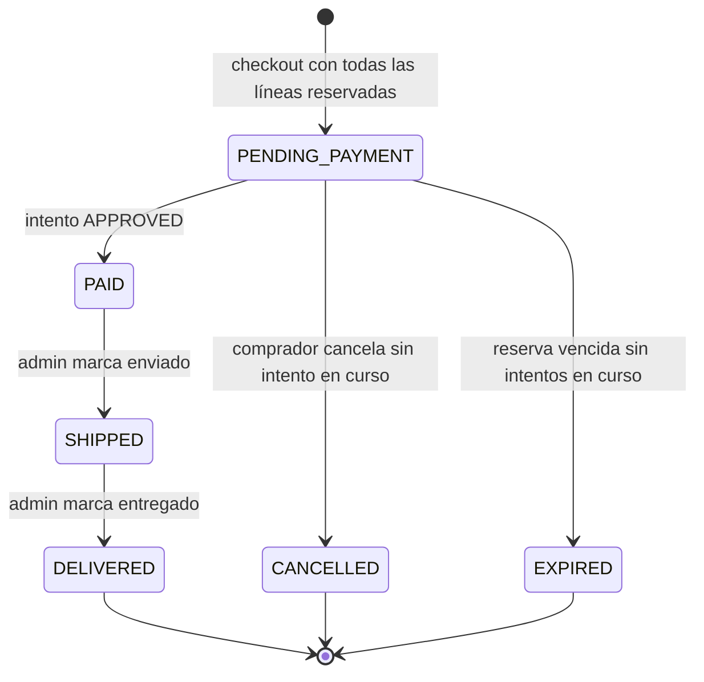
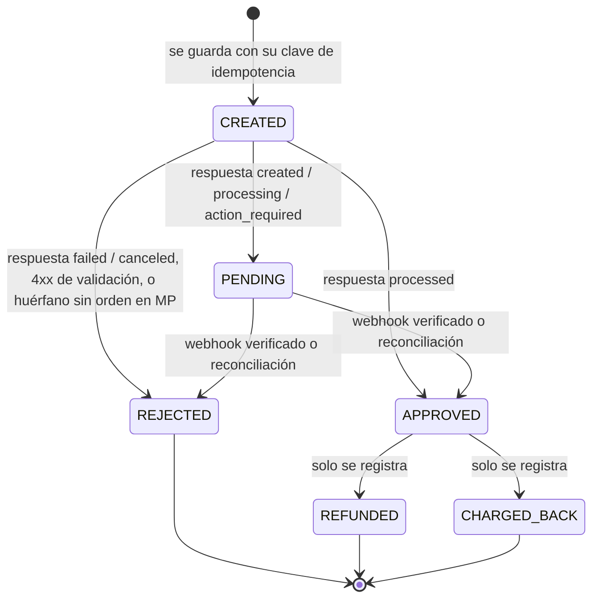
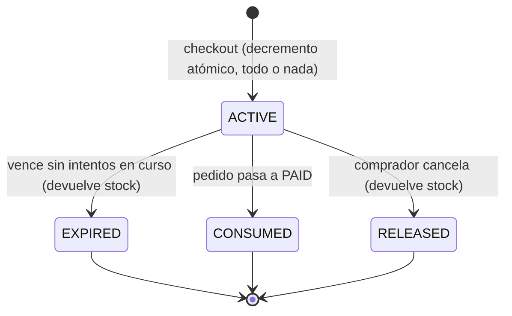
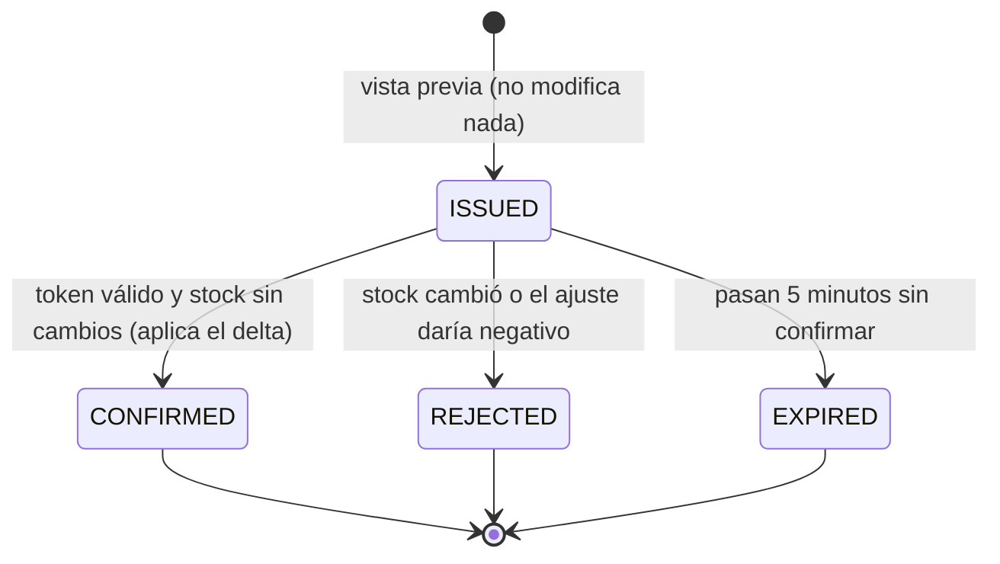

# BitMarket — Diseño funcional

> **Qué** hace el sistema. El **cómo** vive en [`architecture.md`](architecture.md) y en [`adr/`](adr/).
> El problema, el alcance y el stack están en [`brief.md`](brief.md). Este documento no los repite.

## 1. Propósito y alcance

BitMarket es una tienda en línea de tecnología que vende productos con variantes (cada una con su precio y su stock) y cobra con tarjeta por Mercado Pago. Nunca vende stock que no tiene. El administrador puede consultar el negocio desde un asistente de IA por MCP. El alcance del MVP y lo que queda fuera están en [`brief.md` §3 y §4](brief.md).

## 2. Actores

| Actor | Descripción | Cómo se identifica |
| --- | --- | --- |
| Comprador | Persona registrada que compra y sigue sus pedidos. | Usuario de Cognito en el grupo `CUSTOMER`. |
| Administrador | Mantiene el catálogo y el inventario, gestiona los envíos y consulta métricas. | Usuario de Cognito en el grupo `ADMIN`. |
| Mercado Pago | Procesa los pagos y notifica sus cambios de estado. | Firma `x-signature` del webhook. |
| Planificador | Ejecuta los jobs de expiración de reservas y de reconciliación de pagos. | Interno al sistema. |
| Cliente MCP | Asistente de IA que actúa en nombre de un administrador. | Token OAuth de Cognito de un usuario `ADMIN`. |

## 3. Casos de uso

### CU-01 Registrarse e iniciar sesión
- **Actor:** Comprador. **Objetivo:** tener una cuenta para comprar.
- **Flujo principal:**
  1. El comprador elige "Registrarse" y Cognito lo lleva por el registro y la verificación de correo.
  2. Al volver a la tienda con sesión iniciada, el sistema crea el perfil local vinculado al `sub` de Cognito si aún no existe (RN-40).
- **Alternativos:**
  - A1. El usuario ya está registrado: inicia sesión y se reutiliza su perfil local.
  - A2. Olvidó la contraseña: la recuperación la hace Cognito (RN-43).
  - A3. Intenta añadir al carrito sin sesión: el sistema le pide iniciar sesión (RN-10).

### CU-02 Explorar el catálogo
- **Actor:** Comprador o visitante. **Objetivo:** encontrar un producto y elegir una variante.
- **Flujo principal:**
  1. El usuario navega por categoría o busca por nombre (RN-04).
  2. El sistema lista los productos activos que coinciden (RN-07).
  3. El usuario abre un producto y ve sus variantes activas con sus atributos, precio y disponibilidad (RN-01, RN-02).
- **Alternativos:**
  - A1. La búsqueda no encuentra nada: el sistema muestra una lista vacía.
  - A2. Una variante tiene stock disponible 0: se muestra como agotada y no se puede añadir al carrito (RN-12).

### CU-03 Gestionar el carrito
- **Actor:** Comprador. **Objetivo:** reunir las variantes que quiere comprar.
- **Flujo principal:**
  1. El comprador añade una variante activa con una cantidad de 1 a 10 (RN-15).
  2. El sistema guarda la línea en el carrito del usuario en el servidor (RN-10) **sin reservar stock** (RN-11).
  3. El comprador cambia cantidades o quita líneas.
  4. El carrito muestra el precio actual de cada variante y el subtotal (RN-13).
- **Alternativos:**
  - A1. La variante ya está en el carrito: se suma a la línea existente sin pasar de 10 (RN-14, RN-15).
  - A2. El precio cambió desde que se añadió: el carrito muestra el precio nuevo (RN-13).
  - A3. El comprador inicia sesión en otro dispositivo y ve el mismo carrito (RN-10).
  - A4. Un producto o una variante del carrito se desactivó: la línea aparece como no disponible y bloquea el checkout hasta que el comprador la quite (RN-16).

### CU-04 Hacer checkout
- **Actor:** Comprador. **Objetivo:** convertir el carrito en un pedido con el stock reservado.
- **Flujo principal:**
  1. El comprador escribe la dirección de envío (RN-41).
  2. El sistema muestra el subtotal, el envío fijo y el total (RN-50, RN-51).
  3. El comprador confirma.
  4. En una sola transacción, el sistema reserva el stock de **todas** las líneas con un decremento atómico condicionado (RN-31, RN-37) y crea el pedido en `PENDING_PAYMENT` con las copias de nombre, categoría, precio, envío y dirección (RN-21).
  5. La reserva vence a los 15 minutos (RN-32) y el comprador pasa a pagar (CU-05).
- **Alternativos:**
  - A1. Alguna línea no tiene stock suficiente: no se crea el pedido, no se reserva nada y el comprador ve qué líneas faltan (RN-37).
  - A2. Varios compradores piden a la vez la última unidad: solo uno obtiene la reserva y los demás reciben "sin stock" (RN-30, borde B-01).
  - A3. El carrito está vacío o tiene líneas no disponibles: el sistema rechaza el checkout (RN-16).

### CU-05 Pagar un pedido con tarjeta
- **Actor:** Comprador (con Mercado Pago). **Objetivo:** pagar el pedido.
- **Flujo principal:**
  1. El navegador tokeniza la tarjeta con MercadoPago.js o el Card Payment Brick. El backend solo recibe el token (RN-60).
  2. El sistema guarda un intento de pago en `CREATED` con su propia `X-Idempotency-Key` y crea una orden de Mercado Pago con `POST /v1/orders` (RN-61).
  3. Mercado Pago responde la orden en `processed`, el intento pasa a `APPROVED` y el pedido a `PAID` (RN-22).
  4. El comprador ve el pedido confirmado.
- **Alternativos:**
  - A1. Respuesta `failed` o `canceled`: el intento pasa a `REJECTED` y el comprador puede reintentar con otra tarjeta mientras la reserva siga vigente (RN-64).
  - A2. Respuesta `created`, `processing` o `action_required` (3DS, antifraude, procesamiento asíncrono): el intento pasa a `PENDING`, el pedido sigue en `PENDING_PAYMENT`, la reserva no expira mientras tanto (RN-33) y el estado final llega por webhook (CU-12) o por reconciliación (CU-14).
  - A3. `POST /v1/orders` agota el tiempo de espera: se reintenta con la misma clave de idempotencia (RN-62).
  - A4. La reserva ya expiró o el pedido no está en `PENDING_PAYMENT`: el sistema no crea el intento (RN-65).
  - A5. El pedido ya tiene un intento en curso: el sistema no crea otro (RN-69).

### CU-06 Consultar "Mis pedidos"
- **Actor:** Comprador. **Objetivo:** conocer el estado de sus pedidos.
- **Flujo principal:**
  1. El comprador abre "Mis pedidos".
  2. El sistema lista sus pedidos con su estado, sus líneas copiadas, el subtotal, el envío y el total (RN-21, RN-51).
- **Alternativos:**
  - A1. Intenta ver un pedido de otro usuario: el sistema responde como si no existiera (RN-42).

### CU-07 Gestionar el catálogo
- **Actor:** Administrador. **Objetivo:** mantener productos, variantes, categorías e imágenes.
- **Flujo principal:**
  1. El administrador crea o edita un producto: nombre, descripción y una categoría (RN-03).
  2. Añade o edita variantes: SKU, atributos clave-valor, precio en COP y stock inicial (RN-01, RN-02, RN-05).
  3. Ajusta el stock de una variante existente con un delta y un motivo (RN-38).
  4. Sube imágenes: el sistema entrega una URL prefirmada de S3, el navegador sube el archivo y la imagen se sirve por CloudFront (RN-06).
- **Alternativos:**
  - A1. El SKU ya existe: el sistema rechaza el cambio (RN-05).
  - A2. El precio no es un entero positivo: el sistema rechaza el cambio (RN-02).
  - A3. El administrador desactiva o reactiva un producto o una variante. Nunca se borran (RN-07).
  - A4. El ajuste dejaría el stock disponible negativo: el sistema lo rechaza (RN-34).

### CU-08 Seguir pedidos y gestionar el envío
- **Actor:** Administrador. **Objetivo:** despachar los pedidos pagados.
- **Flujo principal:**
  1. El administrador lista los pedidos y los filtra por estado.
  2. Marca un pedido `PAID` como `SHIPPED` y, después, como `DELIVERED` (RN-24).
- **Alternativos:**
  - A1. La transición no es válida (por ejemplo, `PENDING_PAYMENT → SHIPPED`): el sistema la rechaza (RN-20).

### CU-09 Atender alertas de cobro
- **Actor:** Administrador. **Objetivo:** que ningún cobro que requiera reembolso pase inadvertido.
- **Flujo principal:**
  1. El panel muestra una alerta por cada intento `REJECTED` que Mercado Pago reporta después como cobrado (RN-66).
  2. El administrador hace el reembolso a mano, fuera del sistema.
  3. El administrador marca la alerta como atendida, con una nota opcional. El pedido no cambia de estado y la alerta sale de la lista de pendientes (RN-27).

### CU-10 Consultar inventario y ventas por MCP
- **Actor:** Administrador, a través de un cliente MCP. **Objetivo:** responder preguntas de negocio sin armar reportes.
- **Flujo principal:**
  1. El cliente MCP se autentica con OAuth de Cognito como usuario `ADMIN` (RN-70).
  2. El administrador pregunta, por ejemplo, "¿qué productos están por agotarse?" o "¿cuánto se vendió esta semana por categoría?".
  3. El cliente LLM elige una tool tipada de consulta y el sistema responde con datos reales. Las ventas salen de las copias guardadas en los pedidos (RN-72, RN-75) y "por agotarse" usa el umbral de RN-76.
- **Alternativos:**
  - A1. El token no es válido o el usuario no es `ADMIN`: el sistema rechaza la llamada (RN-70).

### CU-11 Ajustar stock por MCP
- **Actor:** Administrador, a través de un cliente MCP. **Objetivo:** corregir el stock de una variante.
- **Flujo principal:**
  1. El cliente llama a la tool de vista previa con el SKU, el delta y el motivo (RN-38).
  2. El sistema devuelve el stock disponible actual, el resultante y un token de confirmación, **sin modificar nada** (RN-73).
  3. El administrador confirma de forma explícita.
  4. El cliente llama a la tool de confirmación con el token y el sistema aplica el delta con la lógica de concurrencia del inventario (RN-74).
- **Alternativos:**
  - A1. El token caducó, ya se usó o pertenece a otro administrador: el sistema no aplica nada (RN-73).
  - A2. El stock disponible cambió desde la vista previa: la confirmación falla y hay que pedir otra vista previa (RN-74).
  - A3. El ajuste dejaría el stock disponible negativo: el sistema lo rechaza (RN-34).

### CU-12 Procesar el webhook de Mercado Pago
- **Actor:** Mercado Pago. **Objetivo:** actualizar el estado de un intento de pago.
- **Flujo principal:**
  1. Llega una notificación y el sistema verifica `x-signature` (RN-63).
  2. El sistema consulta `GET /v1/orders/{id}` y toma el estado de esa respuesta, **no** del cuerpo de la notificación (RN-63).
  3. Aplica la transición del intento y, si corresponde, la del pedido, una sola vez (RN-66).
- **Alternativos:**
  - A1. La firma no es válida: responde 4xx y no hay ningún efecto (RN-63).
  - A2. La notificación está duplicada o llega fuera de orden: no produce una segunda transición (RN-66).
  - A3. El estado es `refunded` o `charged_back`: se registra y no se gestiona (RN-67).
  - A4. El estado es `processed` pero el intento ya está en `REJECTED` (por ejemplo, un huérfano que la reconciliación no encontró): el intento no cambia, se registra el estado y se genera una alerta de cobro (RN-66).

### CU-13 Expirar reservas
- **Actor:** Planificador. **Objetivo:** liberar el stock de los pedidos no pagados.
- **Flujo principal:**
  1. Cada minuto, el job selecciona los pedidos `PENDING_PAYMENT` con la reserva vencida y sin intentos en curso, usando `FOR UPDATE SKIP LOCKED` (RN-33, RN-36).
  2. Por cada pedido, devuelve el stock reservado y pasa el pedido a `EXPIRED` (RN-32).
- **Alternativos:**
  - A1. Varias réplicas ejecutan el job a la vez: cada pedido se procesa una sola vez (RN-36).

### CU-14 Reconciliar pagos pendientes
- **Actor:** Planificador. **Objetivo:** tener el estado del pago aunque se haya perdido un webhook.
- **Flujo principal:**
  1. Cada 5 minutos, el job selecciona los intentos `PENDING` con más de 10 minutos de antigüedad (RN-68).
  2. Consulta `GET /v1/orders/{id}` y aplica la transición igual que en CU-12, pasos 2 y 3.
- **Alternativos:**
  - A1. Intento huérfano en `CREATED` con más de 2 minutos: el job busca la orden en Mercado Pago por la referencia del intento. Si existe, aplica su estado. Si no existe, el intento pasa a `REJECTED` (RN-68).

### CU-15 Cancelar un pedido
- **Actor:** Comprador. **Objetivo:** desistir de un pedido no pagado y liberar el stock.
- **Flujo principal:**
  1. Desde "Mis pedidos", el comprador cancela un pedido propio en `PENDING_PAYMENT`.
  2. El sistema devuelve el stock reservado y pasa el pedido a `CANCELLED` (RN-26).
- **Alternativos:**
  - A1. El pedido tiene un intento en curso: el sistema rechaza la cancelación (RN-26).
  - A2. El pedido no está en `PENDING_PAYMENT`: el sistema rechaza la cancelación (RN-25, RN-26).

## 4. Reglas de negocio

### Catálogo y precios
- **RN-01** El precio y el stock pertenecen a la variante, no al producto.
- **RN-02** Los precios están en COP como enteros positivos, con IVA incluido. No se usan decimales.
- **RN-03** Las categorías tienen un solo nivel, sin subcategorías. Cada producto pertenece a exactamente una categoría.
- **RN-04** La búsqueda del catálogo es solo por nombre de producto. No hay filtros por atributos de variante.
- **RN-05** Cada variante tiene un SKU único en todo el catálogo y atributos clave-valor (por ejemplo, `capacidad=256GB`, `color=negro`).
- **RN-06** Las imágenes se suben a S3 con una URL prefirmada que emite el backend solo para usuarios `ADMIN`, y se sirven por CloudFront.
- **RN-07** Productos y variantes se desactivan y se reactivan, pero nunca se borran. Lo inactivo no se muestra en la tienda ni se puede añadir al carrito ni comprar. Una variante de un producto inactivo cuenta como inactiva.

### Carrito
- **RN-10** El carrito vive en el servidor y hay uno por usuario. Usarlo exige sesión iniciada.
- **RN-11** El carrito no reserva stock.
- **RN-12** No se puede añadir una variante con stock disponible 0.
- **RN-13** El carrito muestra el precio actual de cada variante, no el del momento en que se añadió.
- **RN-14** Cada variante aparece una sola vez en el carrito. Añadirla de nuevo suma la cantidad a la línea existente.
- **RN-15** La cantidad de cada línea es un entero entre 1 y 10, y el máximo es configurable. No hay límite de líneas por pedido.
- **RN-16** Una línea cuyo producto o variante está inactivo se muestra como no disponible y bloquea el checkout hasta que se quite.

### Pedido
- **RN-20** El pedido solo cambia de estado por las transiciones de §5.1. Cualquier otra transición se rechaza.
- **RN-21** Al crearse, el pedido copia de cada línea el nombre del producto, la categoría y el precio unitario, y copia la tarifa de envío y la dirección. Los cambios posteriores del catálogo o de la configuración no alteran esas copias.
- **RN-22** Un pedido pasa a `PAID` solo cuando uno de sus intentos de pago llega a `APPROVED` según Mercado Pago y su stock está reservado.
- **RN-23** El comprador solo crea pedidos para sí mismo, a partir de su carrito.
- **RN-24** Solo un `ADMIN` cambia el estado de envío: `PAID → SHIPPED → DELIVERED`.
- **RN-25** Un pedido `PAID`, `SHIPPED` o `DELIVERED` no se puede cancelar en el MVP, porque cancelarlo implicaría un reembolso.
- **RN-26** Solo el comprador dueño del pedido puede cancelarlo, y solo si está en `PENDING_PAYMENT` y no tiene un intento en curso. Al cancelar, el stock reservado vuelve a estar disponible. El `ADMIN` no cancela pedidos.
- **RN-27** Las alertas de cobro (RN-66) quedan pendientes hasta que un `ADMIN` las marca como atendidas, con una nota opcional. Marcarlas no cambia el estado del pedido.

### Reserva e inventario
- **RN-30** Nunca se vende stock que no existe, ni siquiera con compras simultáneas. El stock disponible nunca es negativo.
- **RN-31** La reserva descuenta el stock disponible con `UPDATE … SET available = available - :qty WHERE sku = :sku AND available >= :qty` y comprueba las filas afectadas: 0 filas significa sin stock. No se usan bloqueos explícitos.
- **RN-32** La reserva se crea con el pedido y vence 15 minutos después. Al expirar, el stock vuelve a estar disponible y el pedido pasa a `EXPIRED`.
- **RN-33** La reserva no expira mientras el pedido tenga algún intento de pago en curso (`CREATED` o `PENDING`, RN-69). No hay un tiempo máximo: un `CREATED` lo resuelve la reconciliación en minutos (RN-68) y un `PENDING` espera a que Mercado Pago lo resuelva. Junto con RN-26 y RN-65, esto garantiza que ningún intento llegue a `APPROVED` en un pedido cuya reserva ya se liberó.
- **RN-34** Ningún ajuste de stock, ni del panel ni del MCP, puede dejar el stock disponible negativo.
- **RN-35** *Retirada el 2026-10-28* ([ADR-0002](adr/0002-reserva-de-stock-con-expiracion.md)): la re-reserva ante una aprobación tardía y el estado `PAID_OUT_OF_STOCK`. Por RN-33, una aprobación nunca llega a un pedido con la reserva liberada.
- **RN-36** El job de expiración se ejecuta cada minuto (configurable) y usa `SELECT … FOR UPDATE SKIP LOCKED`, de modo que es seguro con varias réplicas.
- **RN-37** La reserva es todo o nada: todas las líneas del pedido se reservan en una sola transacción. Si una falla, se revierte todo y no se crea el pedido.
- **RN-38** Después de crear una variante (con su stock inicial), el stock solo cambia con ajustes delta (+/−) que llevan un motivo obligatorio y quedan registrados con el autor, tanto desde el panel como desde el MCP. Desde el panel no hace falta la confirmación en dos pasos.

### Identidad y datos personales
- **RN-40** El perfil local se vincula al `sub` de Cognito. El backend no duplica las credenciales ni los datos que ya guarda Cognito. Única excepción: el almacén de sesiones del BFF guarda el correo y el nombre que Better Auth exige, en un esquema propio de Next.js que el backend no lee.
- **RN-41** No hay libreta de direcciones: la dirección se escribe en cada checkout y solo se guarda como copia en el pedido. Sus campos son destinatario, teléfono, departamento, ciudad y dirección, todos obligatorios, más indicaciones opcionales. Departamento y ciudad son texto libre.
- **RN-42** Un comprador solo ve sus propios pedidos y su propio carrito.
- **RN-43** El registro, la verificación de correo y la recuperación de contraseña los gestiona Cognito. BitMarket no envía correos transaccionales.
- **RN-44** Los roles son los grupos de Cognito `CUSTOMER` y `ADMIN`. El panel de administración y el MCP exigen `ADMIN`. Al confirmar su registro, Cognito añade al usuario al grupo `CUSTOMER` (disparador *Post Confirmation*). El grupo `ADMIN` se asigna a mano.

### Envío
- **RN-50** El envío es una tarifa fija nacional que se define en la configuración de la aplicación (variable de entorno), con un valor por defecto de 15.000 COP. El pedido copia el valor vigente al crearse.
- **RN-51** El pedido guarda por separado el subtotal (Σ precio copiado × cantidad), el envío y el total (subtotal + envío).

### Pagos
- **RN-60** La tarjeta se tokeniza en el navegador. El backend nunca recibe ni guarda datos de la tarjeta, solo el token.
- **RN-61** Cada intento de pago es una orden de Mercado Pago con su propia `X-Idempotency-Key`. El intento se guarda en `CREATED` con esa clave **antes** de llamar a `POST /v1/orders`.
- **RN-62** Si `POST /v1/orders` agota el tiempo de espera o falla sin una respuesta definitiva, se reintenta hasta 3 veces con la **misma** clave de idempotencia y el mismo cuerpo. Un error 4xx de validación pasa el intento a `REJECTED`. Si se agotan los reintentos, el intento queda en `CREATED` y lo resuelve la reconciliación (RN-68). Lo mismo ocurre si Mercado Pago rechaza el reintento por la clave de idempotencia.
- **RN-63** El estado de un pago lo determina Mercado Pago, nunca el cliente. Solo valen la respuesta síncrona de `POST /v1/orders` o un webhook con `x-signature` válida seguido de `GET /v1/orders/{id}`. Un webhook con firma inválida recibe 4xx y no tiene efectos.
- **RN-64** Un pedido puede tener N intentos de pago y solo uno puede llevarlo a `PAID`. Tras un `REJECTED` se puede reintentar con otra tarjeta mientras la reserva siga vigente. Como solo se crean intentos en `PENDING_PAYMENT` (RN-65) y de uno en uno (RN-69), dos intentos no pueden llegar a `APPROVED`; el único cobro inesperado posible es el de RN-66.
- **RN-65** Solo se crea un intento de pago para un pedido en `PENDING_PAYMENT` con la reserva vigente.
- **RN-66** El procesamiento de una notificación es idempotente: la misma notificación recibida varias veces produce como máximo una transición. Un intento nunca sale de un estado final, salvo `APPROVED → REFUNDED`/`CHARGED_BACK`. Si Mercado Pago reporta como `processed` un intento que ya está en `REJECTED`, el intento y el pedido no cambian, se registra el estado de Mercado Pago y se genera una alerta de cobro para reembolso manual (RN-27).
- **RN-67** Los estados de Mercado Pago `refunded` y `charged_back` se registran en el intento y no disparan ninguna gestión automática.
- **RN-68** El job de reconciliación se ejecuta cada 5 minutos. Consulta a la API los intentos `PENDING` con más de 10 minutos de antigüedad y aplica su estado real. También busca en Mercado Pago, por la referencia del intento, la orden de los intentos `CREATED` con más de 2 minutos: si la orden existe, aplica su estado; si no existe, el intento pasa a `REJECTED`. Todos los valores son configurables.
- **RN-69** Un intento está **en curso** si está en `CREATED` o `PENDING`. No se crea un intento nuevo mientras el pedido tenga uno en curso.

### Administración y MCP
- **RN-70** El MCP solo atiende a usuarios `ADMIN` autenticados con OAuth de Cognito.
- **RN-71** El MCP expone tools tipadas de consulta (pedidos, inventario, ventas) y **una sola** tool de escritura: ajustar el stock de una variante.
- **RN-72** Las métricas de ventas se calculan sobre las copias guardadas en los pedidos (RN-21), no sobre el catálogo actual.
- **RN-73** El ajuste de stock por MCP tiene dos pasos: una vista previa que devuelve el stock disponible actual, el resultante y un token de confirmación sin modificar nada, y después la confirmación con ese token. El token vence a los 5 minutos, se puede usar una sola vez y queda ligado al administrador, al SKU, al delta y al stock disponible que mostró la vista previa. Sin un token válido no se aplica ningún cambio.
- **RN-74** La confirmación falla si el stock disponible cambió desde la vista previa. Si no cambió, el delta se aplica con la misma lógica atómica del inventario (RN-31, RN-34, RN-38). Una confirmación fallida deja el token rechazado: no se puede volver a usar (RN-73).
- **RN-75** "Venta" es un pedido en `PAID`, `SHIPPED` o `DELIVERED`, fechado por el momento en que pasó a `PAID`. "Esta semana" va del lunes a las 00:00 hasta ahora, en la zona horaria `America/Bogota`.
- **RN-76** "Por agotarse" significa stock disponible ≤ umbral, entre las variantes activas. El umbral es un parámetro opcional de la tool, con valor por defecto 5.

## 5. Diagramas de estados

### 5.1 Pedido

| Desde | Hacia | Disparador | Regla |
| --- | --- | --- | --- |
| — | `PENDING_PAYMENT` | Checkout con todas las líneas reservadas | RN-21, RN-31, RN-37 |
| `PENDING_PAYMENT` | `PAID` | Intento `APPROVED` (síncrono, webhook o reconciliación) | RN-22, RN-63 |
| `PENDING_PAYMENT` | `EXPIRED` | Job de expiración: reserva vencida y sin intentos en curso | RN-32, RN-33, RN-36, RN-69 |
| `PENDING_PAYMENT` | `CANCELLED` | El comprador cancela sin un intento en curso | RN-26, RN-69 |
| `PAID` | `SHIPPED` | Acción del `ADMIN` en el panel | RN-24 |
| `SHIPPED` | `DELIVERED` | Acción del `ADMIN` en el panel | RN-24 |

`DELIVERED`, `CANCELLED` y `EXPIRED` son finales en el MVP. `EXPIRED` y `CANCELLED` solo se alcanzan sin intentos en curso, así que ninguna aprobación llega después (RN-33). Una alerta de cobro (RN-66) no cambia el estado del pedido (RN-27).

### 5.2 Intento de pago

| Estado interno | Estados de la orden de Mercado Pago | Notas |
| --- | --- | --- |
| `CREATED` | — | Guardado antes de `POST /v1/orders`, todavía sin respuesta definitiva (RN-61, RN-62). Cuenta como en curso. Impide que la reserva expire (RN-33). |
| `PENDING` | `created`, `processing`, `action_required` | Cuenta como en curso. Impide que la reserva expire (RN-33). |
| `APPROVED` | `processed` | Lleva el pedido a `PAID` y consume la reserva (RN-22). Solo puede haber uno por pedido (RN-64). |
| `REJECTED` | `failed`, `canceled` | Final. Permite un nuevo intento si la reserva sigue vigente (RN-64). Un `processed` posterior no lo cambia y genera una alerta de cobro (RN-66). |
| `REFUNDED` / `CHARGED_BACK` | `refunded`, `charged_back` | Solo se registran (RN-67). |

Las transiciones que no aparecen en el diagrama (por ejemplo, `APPROVED → PENDING` o `REJECTED → APPROVED`) se rechazan y quedan registradas (RN-66). Si la rechazada es `REJECTED → APPROVED` (Mercado Pago cobró un intento ya rechazado), además se genera una alerta de cobro (RN-66, RN-27).

Un reembolso parcial llega como `processed` con `status_detail = partially_refunded`: el intento sigue en `APPROVED` y solo se registra el detalle (RN-67). El `status_detail` `expired` de `canceled` o `failed` se trata igual que su estado (`REJECTED`).

### 5.3 Reserva de stock

### 5.4 Confirmación de ajuste de stock por MCP

Un token en cualquier estado distinto de `ISSUED` no se puede usar (un solo uso, RN-73).

## 6. Casos de borde

| ID | Situación | Resolución | Regla / prueba |
| --- | --- | --- | --- |
| B-01 | N compradores hacen checkout a la vez de una variante con stock 1. | Solo una reserva tiene éxito y las demás reciben "sin stock". Exactamente 1 pedido, N−1 rechazados, stock nunca negativo. | RN-30, RN-31. Test de concurrencia en CI. |
| B-02 | La misma notificación de webhook llega dos veces. | La segunda no produce ninguna transición. | RN-66 |
| B-03 | Llegan notificaciones fuera de orden (por ejemplo, `processing` después de `processed`). | El estado se toma de `GET /v1/orders/{id}` y un intento nunca sale de un estado final. | RN-63, RN-66 |
| B-04 | Webhook con `x-signature` inválida o ausente. | 4xx, sin consultar la API y sin efectos. | RN-63 |
| B-05 | El cuerpo del webhook dice `processed` pero la API dice otra cosa. | Manda la API. | RN-63 |
| B-06 | `POST /v1/orders` agota el tiempo de espera. | Se reintenta con la misma `X-Idempotency-Key`, ya guardada en `CREATED`. | RN-61, RN-62. Test de idempotencia. |
| B-07 | Se crea el mismo pago dos veces con la misma clave. | Un solo pago. | RN-61 |
| B-08 | El pago queda `PENDING` y pasan los 15 minutos. | La reserva no expira hasta que el intento se resuelva. La reconciliación lo consulta pasados 10 minutos. | RN-33, RN-68 |
| B-09 | *Retirado.* Aprobación después de `EXPIRED` con stock. | No puede ocurrir: un pedido con intento en curso no expira. | RN-33 |
| B-10 | *Retirado.* Aprobación después de `EXPIRED` sin stock. | No puede ocurrir: un pedido con intento en curso no expira. | RN-33 |
| B-11 | El webhook se pierde. | El job de reconciliación obtiene el estado real. | RN-68 |
| B-12 | El precio de una variante cambia con ella ya en el carrito. | El carrito muestra el precio nuevo y el pedido copia el precio vigente al crearse. | RN-13, RN-21 |
| B-13 | El catálogo o la tarifa de envío cambian después de un pedido. | El pedido y las métricas conservan las copias. | RN-21, RN-72 |
| B-14 | Dos réplicas ejecutan el job de expiración a la vez. | `SKIP LOCKED`: cada pedido se procesa una vez. | RN-36 |
| B-15 | El comprador intenta pagar un pedido `EXPIRED` o `CANCELLED`. | No se crea el intento. | RN-65 |
| B-16 | El comprador intenta un segundo pago mientras el primero está en curso. | Se rechaza. | RN-69 |
| B-17 | *Retirado.* Dos intentos del mismo pedido terminan `APPROVED`. | No puede ocurrir: un solo intento en curso y solo en `PENDING_PAYMENT`. El caso real equivalente es B-29. | RN-64, RN-65, RN-69 |
| B-18 | El stock cambia entre la vista previa y la confirmación del MCP. | La confirmación falla y hay que pedir otra vista previa. | RN-74 |
| B-19 | Se reutiliza un token MCP, ya caducado o de otro administrador. | Se rechaza sin efectos. | RN-73 |
| B-20 | Un ajuste (panel o MCP) dejaría el stock disponible negativo. | Se rechaza. | RN-34 |
| B-21 | Un usuario no `ADMIN` llama al MCP o al panel. | Se rechaza. | RN-44, RN-70 |
| B-22 | El comprador pide un pedido ajeno por su ID. | Se responde como no encontrado. | RN-42 |
| B-23 | Se desactiva una variante que está en carritos. | Las líneas aparecen como no disponibles y bloquean el checkout hasta que se quiten. | RN-07, RN-16 |
| B-24 | Se desactiva una variante con pedidos `PENDING_PAYMENT` en curso. | Los pedidos siguen su flujo. La desactivación solo afecta a compras nuevas. | RN-07, RN-21 |
| B-25 | El comprador cancela con un intento en curso. | Se rechaza. | RN-26 |
| B-26 | Una línea pasa de 10 unidades al sumar desde el carrito. | Se rechaza el cambio y la línea conserva su cantidad. | RN-15 |
| B-27 | Se agotan los reintentos de `POST /v1/orders` o el proceso cae tras guardar el intento. | El intento queda en `CREATED`, bloquea nuevos intentos y la reconciliación lo resuelve buscando por la referencia: aplica el estado real o lo pasa a `REJECTED`. | RN-62, RN-68, RN-69 |
| B-28 | La reserva vence mientras el pedido tiene un intento en `CREATED` (llamada en vuelo o huérfana). | La reserva no expira. Cuando el intento se resuelve, sigue su flujo: `APPROVED` lleva el pedido a `PAID`; `REJECTED` deja el pedido sin intentos en curso y el job de expiración lo procesa. | RN-33, RN-68, RN-69 |
| B-29 | La reconciliación pasa a `REJECTED` un `CREATED` huérfano cuya orden no encontró, y después llega un webhook con esa orden en `processed`. | El intento sigue en `REJECTED`, se registra el estado y se genera una alerta de cobro para reembolso manual. El pedido no cambia. Si sigue en `PENDING_PAYMENT`, el comprador puede pagar de nuevo: el doble cobro se resuelve con la misma alerta (consecuencia aceptada). | RN-66, RN-27 |

## 7. Glosario

| Término | Definición |
| --- | --- |
| Producto | Artículo del catálogo con nombre, descripción, una categoría e imágenes. No tiene precio ni stock. |
| Variante | Versión concreta de un producto (capacidad, color, configuración) con SKU, atributos, precio y stock. Es lo que se compra. |
| SKU | Identificador único de una variante. |
| Atributo | Par clave-valor que distingue una variante (`color=negro`). |
| Categoría | Agrupación de un solo nivel de productos. |
| Activo / inactivo | Marca de productos y variantes. Lo inactivo no se vende, pero se conserva. |
| Stock disponible (`available`) | Unidades de una variante que todavía se pueden reservar. |
| Ajuste de stock | Cambio delta (+/−) del stock disponible, con motivo y autor registrados. |
| Reserva | Unidades descontadas del stock disponible para un pedido mientras se paga. Vence a los 15 minutos (salvo RN-33). |
| Carrito | Lista de variantes y cantidades de un usuario, guardada en el servidor y sin reserva. |
| Pedido | Compra de un comprador con líneas, dirección, subtotal, envío y total copiados al crearse. |
| Copia (snapshot) | Datos del catálogo, del envío y de la dirección copiados al pedido para que el histórico no cambie. |
| Intento de pago | Cada llamada de cobro para un pedido. Un pedido puede tener varios. |
| Orden de Mercado Pago | Recurso de la Orders API de Mercado Pago (`ORD…`) que se crea por cada intento de pago. No confundir con el pedido de BitMarket. |
| Intento en curso | Intento en `CREATED` o `PENDING`. |
| Clave de idempotencia | Valor de `X-Idempotency-Key` que evita cobros duplicados al reintentar. |
| Webhook | Notificación HTTP de Mercado Pago sobre un cambio de pago, autenticada con `x-signature`. |
| Reconciliación | Consulta periódica a la API de los pagos que siguen pendientes. |
| Alerta de cobro | Aviso en el panel por un cobro sobre un intento ya `REJECTED` (RN-66). Queda pendiente hasta que se marca como atendida. |
| Venta | Pedido en `PAID`, `SHIPPED` o `DELIVERED`, fechado al pasar a `PAID`. |
| Tarifa de envío | Monto fijo nacional que se suma al subtotal. |
| Tool MCP | Operación tipada que el servidor MCP expone a un cliente LLM. |
| Token de confirmación | Valor que emite la vista previa de un ajuste MCP. Es de un solo uso y vence a los 5 minutos. |
| COP | Peso colombiano. Se maneja como entero, con IVA incluido. |

## 8. Preguntas abiertas

- **P-01 Cliente MCP y OAuth con Cognito.** La especificación de autorización de MCP (revisión 2026-07-28) admite tres formas de obtener el client ID: documentos de metadatos de cliente (recomendada), registro previo y registro dinámico (obsoleta). Cognito solo admite el registro previo, así que el riesgo es que el cliente MCP de la demo permita configurar un client ID registrado de antemano. Además, el servidor MCP debe validar que el token se emitió para él (audiencia, RFC 8707), lo que Cognito ofrece con *resource indicators* en Managed Login (plan Essentials). Se resuelve con un spike temprano (primero MCP Inspector con un client ID registrado de antemano, luego el cliente de la demo). Plan B: un proxy de autorización delgado delante de Cognito.
